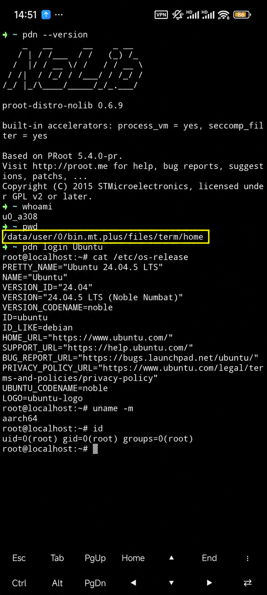

# proot-distro-nolib

[简体中文](README.md) | English

**ARM64 Android**. Find the current version on [GitHub Releases](https://github.com/EMERLADD/proot-distro-nolib/releases) and changes in [CHANGELOG](CHANGELOG.en.md).

Rootless Linux distribution manager and embeddable SDK for ARM64 Android. Run Debian, Ubuntu, Alpine and Arch without Termux.

[](https://central.sonatype.com/artifact/io.github.emerladd/pdn-engine/0.6.18)

## Quick start

[](docs/pdn-shizuku-android-shell.en.md)
[](docs/android-embedding.en.md)
[](#31-deploy-to-android-shell)

## Contents

- [0. What is this?](#0-what-is-this)
- [1. Requirements and permissions](#1-requirements-and-permissions)
- [2. Downloads and updates](#2-downloads-and-updates)
- [3. Quick start](#3-quick-start)
- [4. Verified use cases](#4-verified-use-cases)
- [5. Documentation](#5-documentation)
- [6. Building and contributing](#6-building-and-contributing)
- [7. Origins and licenses](#7-origins-and-licenses)
- [8. Frequently asked questions](#8-frequently-asked-questions)
- [9. Current limitations](#9-current-limitations)

## 0. What is this?

**PDN is a rootless Linux distribution manager and embeddable SDK for ARM64 Android, based on [pr](https://github.com/oonid/pr).** It combines the PRoot engine, downloads, verification, extraction and distribution management in one ARM64 Android program. It lets Android devices run Linux environments without installing Termux or requiring the host to provide Bash, Python, curl or tar.

<p align="center">
  
</p>

**Device demonstration: from MT Manager into Ubuntu.** MT Manager’s built-in terminal emulator runs an Android shell with ordinary App privileges. The yellow outline marks MT’s private directory, `/data/user/0/bin.mt.plus/files/term/home`. Running `pdn login Ubuntu` enters Ubuntu 24.04 LTS (ARM64). Linux `root` is simulated by PRoot and does not grant Android root privileges; this path requires neither Termux nor Shizuku. The screenshot retains its original version number; see the [unannotated original](docs/images/mt-ubuntu-original.jpg).

- **Manage Linux directly**: install, log in, execute commands, bind project directories, save configuration, back up, restore and remove distributions.
- **Callable from other APKs**: two integration options, AAR and directly packaged `.so` files, for workspaces, AI frontends and other Apps needing Linux execution.
- **GUI and terminal support**: Java/Kotlin APIs provide structured events, error suggestions, asynchronous tasks and independent PTY terminal sessions. The host draws the interface.
- **Host-controlled paths**: executable, data, cache and project directories come from arguments or the host, without binding to MT Manager, Termux or a fixed App package name.
- **Android debugging when permissions allow**: starting PDN from Shizuku/rish or ADB shell lets Linux call Android debugging commands such as `cmd`, `settings` and `getprop` with inherited privileges.

The main paths above have been verified with **MT Manager, an independent APK built with the AAR, and an independent APK directly packaging `.so` files**. See [verified use cases](#4-verified-use-cases) for results. The Android debugging path verifies system commands with ADB shell-level privileges, not actual Android root or the full functionality of a standalone adb client inside Linux.

| Integration method | Best suited for |
| --- | --- |
| Original ELF (`pdn`) | Terminal tools, shell environments and MT Manager |
| AAR | Kotlin / Java Android Apps that want packaged APIs |
| Direct `.so` packaging | Android Apps that manage processes, events and PTY themselves |

`nolib` means no dependency on Termux dynamic libraries. PDN still uses Android's `libc.so` and `libdl.so`; download, TLS and extraction components are statically linked. AAR integration also needs the Kotlin standard library: Maven brings it transitively, while local AAR imports require it explicitly.

## 1. Requirements and permissions

- **Architecture and version**: ARM64 / AArch64 is currently provided. The standalone ELF targets Android API 24; AAR/JNI integration requires API 28 or later.
- **Execution and tracing**: the host must permit executable launch, PRoot process tracing and related system calls. Ordinary Apps can deploy the programs to `nativeLibraryDir` as described in the integration guide.
- **Linux storage**: an accessible directory supporting Unix permissions and symbolic links, such as App-private storage or Android shell's `/data/local/tmp`. `/sdcard` is suitable for downloads, backups and shared files, not rootfs extraction.
- **Networking and shared files**: online installation needs network permission; shared storage requires the corresponding access permissions.

PRoot's root identity is simulated; the host's actual UID and SELinux restrictions still apply. Shizuku is an optional privilege entry point, not a requirement for installing or running Linux. See the [Android shell tutorial](docs/pdn-shizuku-android-shell.en.md) and [App integration guide](docs/android-embedding.en.md).

## 2. Downloads and updates

The project is currently in testing.

Get matching files from [Releases](https://github.com/EMERLADD/proot-distro-nolib/releases) and verify `SHA256SUMS`:

| Use case | Files |
| --- | --- |
| Android shell / MT terminal | `pdn`, with matching `proot-loader` when an external loader is needed |
| Java/Kotlin App integration | `pdn-engine-VERSION.aar` |
| App-managed process launch | `libpdn.so`, `libproot-loader.so` |
| Source and license materials | `proot-distro-nolib-vVERSION-android-arm64.tar.gz` |
| Independent App integration tests | `pdn-aar-probe-VERSION-*-test.apk`, `pdn-so-probe-VERSION-*-test.apk` |

Both test Apps offer Debug and R8 Release builds demonstrating AAR / direct `.so` integration. All use test signing keys and are not production Apps.

The AAR contains Java/Kotlin APIs and three native files: PDN, its loader and PTY JNI. All terminal session APIs are retained; the host App provides the terminal interface. The standard and lite files have identical contents, so import either one. PDN and its loader use `.so` filenames for APK packaging but are invoked through processes; `libptyjni.so` is called through JNI.

Exit old Linux sessions before updating, replace the program and restore its executable permissions. Existing rootfs installations do not need reinstalling. Keep ELF, `.so`, AAR and loader versions aligned; both `pdn version` and `pdn --version` should report the current PDN version. Retain corresponding source and licenses when redistributing binaries.

See [building and release files](docs/pdn-build-and-release.en.md) for file structure and update precautions.

## 3. Quick start

### 3.1 Deploy to Android shell

This example applies to Android shell environments permitted to execute from `/data/local/tmp`, such as ADB or an already connected Shizuku/rish shell. Ordinary terminal Apps should use their own accessible executable directories. Do not try to initialize the original rish in App-private storage after entering Android shell.

Download `pdn` and `proot-loader`, then adjust the two source paths to their actual locations:

```sh
mkdir -p /data/local/tmp/pdn
cp /sdcard/Download/pdn /data/local/tmp/pdn/pdn
cp /sdcard/Download/proot-loader /data/local/tmp/pdn/proot-loader
chmod 755 /data/local/tmp/pdn/pdn /data/local/tmp/pdn/proot-loader
cd /data/local/tmp/pdn
./pdn version
```

Select Linux and temporary directories:

```sh
export PDN_ROOTFS_DIR=/data/local/tmp/pdn/linux
export PROOT_TMP_DIR=/data/local/tmp/pdn/tmp
export PROOT_LOADER=/data/local/tmp/pdn/proot-loader
mkdir -p "$PROOT_TMP_DIR"
```

The current working directory does not automatically determine rootfs storage. Android shell may set `HOME=/`, so configure paths explicitly. See the [Android shell tutorial](docs/pdn-shizuku-android-shell.en.md) for complete steps and the MT example.

The AAR accepts document URIs, descriptors and streams for archive import and backup export. The example App includes document-picker buttons; see the [AAR API](docs/pdn-aar-api.en.md).

Use `pdn recovery list` to inspect interrupted installation staging and `pdn recovery clear --yes` for explicit cleanup. Installed systems, unknown entries and resume cache are preserved; see [distribution management](docs/pdn-distributions.en.md#interrupted-installation-checks-and-cleanup).

### 3.2 Install, log in and manage distributions

```sh
./pdn list --available
./pdn install ubuntu
./pdn login ubuntu
```

After exiting Linux, execute a command or manage the system from the host shell:

```sh
./pdn exec ubuntu -- /bin/sh -c 'echo hello; uname -r'
./pdn mirrors ubuntu
./pdn list
```

After an online download is interrupted or cancelled, repeat the same installation with the same rootfs management directory to automatically attempt resuming from the same mirror URL. There is no automatic background retry. Extraction requires the full pinned size and SHA256 to match; see [distribution management](docs/pdn-distributions.en.md).

Alpine, Ubuntu Base, Debian slim and Arch Linux ARM are supported. See [distribution management](docs/pdn-distributions.en.md) for official sources, offline archives, binds, accounts, default configuration, backups and the full command index.

Install the same distribution under separate names, each with its own rootfs:

```sh
./pdn install alpine --name ai-python
./pdn install alpine --name ai-node
./pdn login ai-python
./pdn list --json
```

Names contain up to 128 ASCII letters, digits, underscores, dots or hyphens, starting with a letter, digit or underscore. Collisions are case insensitive. New instances record a stable ID, provenance, version, digest and creation time. Legacy rootfs queries return `instance: null` without modifying them; restoring a backup creates a fresh ID.

Cloning creates a new ID. Renaming keeps the original ID and migrates rootfs-owned links and saved bind paths. Exit active instance sessions first:

```sh
./pdn clone ai-python ai-python-test
./pdn rename ai-python-test workspace-python
./pdn login workspace-python
```

### 3.3 Call Android debugging commands from Linux

Start the original `rish` from the authorized host first, confirm the actual Android shell identity with `id`, then deploy PDN as above. Start Ubuntu with these binds from Android shell:

```sh
./pdn login ubuntu --bind /system --bind /apex --bind /linkerconfig/ld.config.txt
```

Inside Ubuntu, define a command with a name of your choice:

```sh
rish() {
    /system/bin/sh -c 'export PATH=/system/bin:/system/xbin; exec /system/bin/sh "$@"' -- "$@"
}
rish -c 'getprop ro.build.version.sdk'
rish -c 'cmd package path android'
```

Here `rish` is a Bash function calling Android shell with inherited privileges; it does not reconnect to Shizuku. Starting from ADB shell does not need Shizuku. When using Shizuku, keep the authorized host in the foreground: the tested environment disconnected in the background even with battery usage set to unrestricted.

Save directory variables in a configuration file and create an `ubuntu-android` entry that loads them and supplies the Android mounts. See [persistent settings and login entry](docs/pdn-shizuku-android-shell.en.md#save-directory-variables-and-a-dedicated-login-entry).

See the [complete tutorial](docs/pdn-shizuku-android-shell.en.md) for original rish setup, saving the function to `.bashrc`, verifying and cleaning up Android settings changes, reconnection and common errors.

### 3.4 Integrate an App with the AAR

1. Enable `mavenCentral()` in the dependency repositories in `settings.gradle.kts`, then add the dependency below. The Kotlin standard library is transitive. Alternatively, import a local AAR and provide the standard library manually.
2. Configure network permission and native library extraction; provide executable, data, cache and project directories from the host.
3. Prepare operations with `PdnRuntime`, then start tasks and receive events and results through `PdnOperations`.
4. For interactive terminals, use `PdnTerminal`; the App renders the interface and handles the lifecycle.

```kotlin
dependencies {
    implementation("io.github.emerladd:pdn-engine:0.6.18")
}
```

For ordinary task input, use `startInteractive()`, `task.writeStdin()` and `task.closeStdin()`; see the [stdin API](docs/pdn-aar-api.en.md#ordinary-task-input-stdin). Default tasks still close input.

```java
PdnRuntime pdn = new PdnRuntime(host);
PdnOperations operations = new PdnOperations(pdn);
PdnTask task = operations.start(pdn.install("alpine"), listener);
```

`host` implements `ProotHost`; `listener` implements `PdnListener`. `install()` itself returns an unstarted `ProcessBuilder`. See [App integration](docs/android-embedding.en.md) for packaging, the [AAR API](docs/pdn-aar-api.en.md) for tasks, queries, configuration and terminals, and the [AAR example](examples/aar-probe/README.en.md) for a runnable project.

### 3.5 Integrate an App by directly packaging `.so` files

1. Place matching `libpdn.so` and `libproot-loader.so` under `app/src/main/jniLibs/arm64-v8a/`.
2. Enable native library extraction and locate the executables through `context.applicationInfo.nativeLibraryDir`.
3. Set rootfs, cache and bind directories through process arguments, then launch with `ProcessBuilder` or your own PTY layer.
4. Read structured results from the separate event channel; preserve stdout/stderr for Linux command output.

These ELFs are not invoked with `System.loadLibrary("pdn")`. Directory layout, environment and event details are in [App integration](docs/android-embedding.en.md) and the [event protocol](docs/pdn-events.en.md). See the [.so example](examples/so-probe/README.en.md) for a complete project.

## 4. Verified use cases

| Use case | Result |
| --- | --- |
| Maven Central integration | Java/Kotlin dependency resolution works; Debug and R8 Release Apps passed installation, command, event, stdin and PTY checks |
| MT Manager / Android shell | Install and start Linux; call Android debugging commands from Ubuntu with inherited shell privileges |
| Independent AAR APK | Debug and R8 Release passed initialization, installation, commands, events, workspace, asynchronous tasks and interactive terminal checks |
| Independent direct `.so` APK | Debug and R8 Release passed independent process, event and PTY integration checks |
| Install Linux software through a GUI | Installing nano and curl in Alpine, and HTTPS access passed |

Both APK paths run under ordinary Android App identities; simulated Linux root does not change host permissions.

## 5. Documentation

| Goal | Documentation |
| --- | --- |
| Run Linux and debug Android from Android shell / MT | [Android shell tutorial](docs/pdn-shizuku-android-shell.en.md) |
| Install, log in, bind, configure, back up or remove Linux | [Distribution management](docs/pdn-distributions.en.md) |
| Embed PDN in another APK | [App integration](docs/android-embedding.en.md) |
| Look up Java/Kotlin configuration, tasks, queries and terminals | [AAR API](docs/pdn-aar-api.en.md) |
| Handle events or investigate classified errors | [Event protocol](docs/pdn-events.en.md), [Error reference](docs/pdn-errors.en.md) |
| Check upstream archives and SHA256 | [Rootfs sources](docs/pdn-rootfs-sources.md) |
| Build from source and redistribute | [Building and releasing](docs/pdn-build-and-release.en.md) |
| Diagnose directory, version, permission or terminal issues | [Frequently asked questions](docs/pdn-faq.en.md) |
| Find complete CLI details | [Native CLI manual](docs/proot-distro-nolib.md) |

## 6. Building and contributing

Standalone PDN does not need Java, Gradle or Rust to build; the AAR needs the Android/Gradle toolchain. See [building and releasing](docs/pdn-build-and-release.en.md) for dependencies, NDK configuration, native and AAR artifacts and license delivery.

[Issues](https://github.com/EMERLADD/proot-distro-nolib/issues) are welcome for bugs, ideas and documentation improvements. Include the host App, Android version, `pdn version`, reproduction commands and error output. Do not include passwords, tokens, device serials or other private information. See [CHANGELOG](CHANGELOG.en.md) for changes.

## 7. Origins and licenses

The project is based on [oonid/pr](https://github.com/oonid/pr), retaining its Android PRoot adaptations and original author information. The engine comes from [PRoot](https://github.com/proot-me/proot) / [Termux PRoot](https://github.com/termux/proot); usage draws on [proot-distro](https://github.com/termux/proot-distro).

Build components include [talloc / Samba](https://www.samba.org/), [curl](https://curl.se/), [Mbed TLS](https://github.com/Mbed-TLS/mbedtls), [libarchive](https://www.libarchive.org/) and [zlib](https://zlib.net/). The engine retains GPL-2.0-or-later, and talloc uses LGPL-3.0-or-later. See [LICENSE](LICENSE) and bundled license materials for each component's scope; the project cannot be uniformly declared MIT.

Retain corresponding source, third-party licenses and build information when redistributing binaries. See [release materials](docs/pdn-build-and-release.en.md).

## 8. Frequently asked questions

| Problem | Quick check |
| --- | --- |
| Rootfs or temporary directory is inaccessible | Check actual identity, explicit path variables, directory existence and permissions. |
| Updated version still reports an old release | Run with a full path; check PATH, copied files and embedded APK copies. |
| Rish is missing inside Ubuntu or the prompt stays at `>` | Define the Bash function first; cancel unfinished input with Ctrl+C and copy the complete code block. |
| Shizuku/rish disconnects | Keep the host foregrounded, check authorization and service status, and reconnect after a restart. |
| App cannot execute `.so` files | Check `nativeLibraryDir`, extraction and matching loader. |
| Command fails without a Java exception | Check `PdnResult.isSuccess()`, error code, reason and suggestion. |

See [frequently asked questions](docs/pdn-faq.en.md) for commands and troubleshooting paths.

## 9. Current limitations

- **Instance migration**: clone follows backup copying rules. Rename migrates rootfs-owned host-absolute links and saved binds; arbitrary file contents and environment strings are not rewritten. Handled SIGINT/SIGTERM can roll back; SIGKILL/power-loss recovery is not implemented.

- **Platform**: ARM64 Android is currently provided. There is no cross-architecture emulation or guarantee of compatibility with every ROM, App or permission environment.
- **Permissions and isolation**: PRoot provides neither actual root nor a security isolation boundary. Shizuku/shell privileges remain restricted by Android; a standalone adb client inside Linux is outside the debugging flow described here.
- **System call compatibility**: The native ELF selects its tracing path based on inherited seccomp filters and inspection results. Existing filters, inspection failures and explicit disabling use full tracing. Ordinary Apps and the AAR use the compatibility policy.
- **Distribution sources**: only built-in pinned archives are supported; offline installation also requires matching checksums. General OCI/Docker image import and automatic mirror latency ranking are not supported.
- **UI and background execution**: the AAR provides terminal sessions, without a terminal rendering widget or full desktop. There is no automatic background session service. The tested Shizuku flow requires the host to stay foregrounded.
- **Releases and updates**: The advanced feature for automatically fetching source, patching and updating PRoot on the device is not implemented.
- **Legacy pr interfaces**: the AAR excludes legacy pr native components. Retained compatibility classes with methods requiring old pr-cli cannot run those methods using only the PDN AAR.
